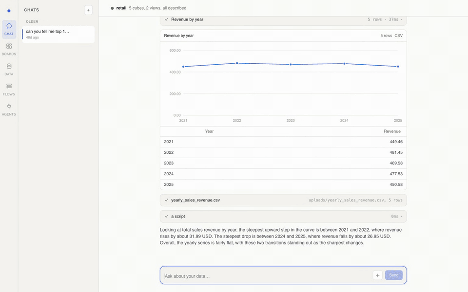

# analyst-agent

[](https://rustify.tech)
[](LICENSE)
[](CONTRIBUTING.md)

Ask questions about your data in plain English, and run repeatable data work step by step.

**[Documentation and website → rustify.tech](https://rustify.tech)**

[](https://rustify.tech)

<sub>A real session against a retail warehouse: a question becomes a checked Cube query and a
chart, the model it was checked against, then a four-step Flow Run with every output counted.</sub>

analyst-agent sits on top of your SQL warehouse. It does five things:

1. **Connects** to almost any SQL warehouse.
2. **Builds a semantic layer** on top of it: what each table means, how tables join, and which
   numbers you can add up.
3. **Lets you shape views and meaning** (an ontology) on top of that layer.
4. **Answers questions through Cube queries**, not SQL written by an AI.
5. **Runs agentic workflows** (Flows): data work done in clear steps, with files you can open
   and a person who checks each step.

Everything runs on your machine. One portal in your browser, one process.

**Full documentation** is at **[rustify.tech](https://rustify.tech)**: getting started, a user
guide, Flow authoring, operating, architecture and the API. Its source is [`docs/`](docs/index.md);
`make docs` serves it locally.

---

## How it fits together

```
   You (browser)
        │
        ▼
 ┌──────────────────────────┐
 │  analyst portal          │   chat · dashboards · data · flows
 │  (this repository)       │   holds no data, only addresses and credentials
 └──────┬─────────────┬─────┘
        │ Cube JSON   │ Python scripts
        ▼             ▼
 ┌──────────────┐  ┌─────────────┐
 │ model store  │  │  sandbox    │   runs Python on files,
 │ + Cube       │  │             │   has no database password
 └──────┬───────┘  └─────────────┘
        │ SQL (written by Cube, not by the AI)
        ▼
 ┌──────────────┐
 │ your SQL     │   Postgres, Snowflake, BigQuery, ...
 │ warehouse    │
 └──────────────┘
```

The AI never talks to your warehouse. It talks to Cube, and Cube talks to the warehouse.

---

## 1. Connect any SQL warehouse

Open **Data** in the left rail and choose **Connect a database**. Pick your warehouse type and
fill in the form.

Supported warehouses:

| Postgres | MySQL | SQL Server | Redshift |
|---|---|---|---|
| **Snowflake** | **BigQuery** | **Databricks** | **Athena** |
| **ClickHouse** | **Trino** | **DuckDB** | |

The portal does not start anything itself. After you fill in the form, it gives you two
ready-made `docker compose` files:

- **Semantic layer**: the model store, Cube, and Cube Store.
- **Sandbox**: where Python scripts run.

Save each file anywhere, run `docker compose up -d` next to it, and paste the two addresses
back into the portal. That is the whole connection.

A database on your own machine is `host.docker.internal` from inside a container, not
`localhost`.

---

## 2. Build the semantic layer

A semantic layer is a description of your data that a computer can check. It says:

- which tables matter,
- what each column means,
- how tables join to each other,
- which numbers can be added up (measures) and which values you group by (dimensions).

The portal builds it in four steps. You can run each step again on its own.

| Step | What happens |
|---|---|
| **Read tables** | Reads every schema and table in the warehouse, and remembers it. |
| **Build cubes** | You pick tables. Each table becomes a *cube* with its keys and joins. |
| **Describe with AI** | The AI writes a description for each table and column, and suggests measures. |
| **Build views** | Builds *views* that combine joined cubes into one clean surface. |

The AI gives **decisions**, never files. The portal writes the files, and **Cube checks them**.
If Cube does not accept a new model, the old model keeps working. Nothing you are using
breaks.

The model is kept in the **model store**, with full history, like code in git.

---

## 3. Views and ontology

The semantic layer is also your **ontology**: the shared meaning of your business data.

| Concept | What it means here | Example |
|---|---|---|
| **Cube** | One business thing, built from one table | `dim_stores`, `fact_daily_sales` |
| **Measure** | A number you can add up or count | `total_revenue`, `total_units_sold` |
| **Dimension** | A value you group or filter by | `region`, `category`, `sale_date` |
| **Join** | How two things relate | a sale belongs to a store |
| **View** | A clean, joined surface for questions | `daily_sales` = sales + stores + items |
| **Description** | What a table or column means, in words | "Revenue after discounts, in GBP" |
| **Agent note** | A hint for the AI about how to use it | "Use `sale_date` for time, not `created_at`" |
| **Folder** | Groups members inside a view | "Store", "Product", "Money" |

Views are what people and the AI ask questions against. They hide the raw join details and show
one clear set of names.

**Change the model safely.** Open the model on a *branch*, not on `main`. You can edit the YAML
files yourself, or ask the editor chat to make the change. Every change is checked before it is
saved:

- Cubes are append-only: you can add and describe, but you cannot rename or remove.
- Views can be changed freely.
- **Validate** asks Cube to compile the branch, and checks every saved dashboard query against
  it.
- **Merge** moves the branch into `main`. It refuses if the change would break a saved query.

A model change is live within seconds. Cube does not need a restart.

---

## 4. Ask questions with Cube queries, not AI-written SQL

When an AI writes SQL, a small mistake gives a **number that looks right but is wrong**: a
wrong join, a double count, a missing filter. You cannot easily see the mistake in a long SQL
query.

Here, the AI never writes SQL. It writes a small **Cube JSON query** instead:

```json
{
  "measures":   ["daily_sales.total_revenue"],
  "dimensions": ["daily_sales.dim_stores_region"],
  "timeDimensions": [
    { "dimension": "daily_sales.sale_date", "granularity": "week" }
  ],
  "order": { "daily_sales.total_revenue": "desc" }
}
```

You can read this in a few seconds: *revenue, by region, by week, biggest first.* Every name in
it comes from the semantic layer. Cube turns it into correct SQL, with the joins already known.

Why this is safer:

| AI writes SQL | AI writes a Cube query |
|---|---|
| Can join any table in any way | Can only use joins the model defines |
| Can invent a formula for "revenue" | Can only use the defined `total_revenue` |
| A mistake often still runs | A mistake fails with a clear message |
| Hard to check by eye | Easy to check by eye: a short list of names |

Every query passes **four checks** before it touches the warehouse:

| Check | What it checks | Cost |
|---|---|---|
| 1. Shape | Is it a valid Cube query? | free |
| 2. Meaning | Do the names exist? Does each filter fit its type? Is the time grain allowed? | free |
| 3. Compile | Can Cube turn it into SQL? (nothing runs yet) | one small call |
| 4. Run | Run it, with a row limit and a time limit | warehouse |

When a check fails, the AI gets a message it can fix, for example *"`orders.cnt` does not
exist; did you mean `orders.count`?"*. It corrects the query and tries again.

In **Chat** you see every step: which names the AI looked up, the Cube query, the SQL Cube made,
and the result as a table and a chart.

---

## 5. Agentic workflows (Flows)

A **Flow** is data work you repeat, for example "every Monday, forecast demand and plan stock
transfers". It runs in **phases**, one after another. You can check the result of each phase
before the next one starts.

### A Flow is a folder

There is no hidden database for a Flow. **The folder is the Flow.** You can open it, read it,
copy it, and keep it in git.

```
flows/store-replenishment/
  flow.yml                  title and description
  CONTEXT.md                what this flow is for (the AI reads this)
  _config/                  rules every run follows
    replenishment-rules.md
  phases/
    01_pull/                phase 1: get the data
      phase.yml             what it reads, what it must write
      CONTEXT.md            instructions for this phase
      queries/
        stock_position.json a prepared Cube query
    02_forecast/            phase 2: compute
      phase.yml
      forecast.py           a prepared Python script
    03_review_forecast/     phase 3: write a summary for a person
    04_transfer_plan/       phase 4: plan the transfers
  runs/
    20261005T020335-da6bbf/ one run: every file it made, and its log
```

The number in the folder name **is the order**: `01` runs first, then `02`.

A phase says what it needs and what it makes, in `phase.yml`:

```yaml
kind: agent                 # an AI step (or "script": a fixed script, no AI)
review: required            # stop here so a person can check the output
tools: [query, python]      # what this phase may use
inputs:
  - reference: _config/replenishment-rules.md   # a rule, the same every run
  - working: brief.md                            # this run's request
outputs:
  - stock_position.csv
queries: [stock_position.json]                   # prepared Cube queries
scripts: [shape_pull_outputs.py]                 # prepared Python scripts
```

### Data goes to files, not to the AI

This is the most important rule of a Flow:

- A query in a Flow writes **every row to a CSV file**. There is no 5,000-row limit. Large
  results are read from Cube in pages of 50,000 rows.
- The AI sees only the **shape** of a file: its columns, how many rows it has, and a few sample
  rows. It never sees all the data.
- Python scripts in the sandbox do the real work on the full files.
- Each phase's files go into its own `output/` folder, which the next phase reads.

### Prepared work

When you create a Flow, the flow chat writes the **queries and scripts in advance** and checks
each query against the model. So a run does not search the model or write new code each time.
The AI in a phase runs the prepared work, and **writes its own only if the brief asks for
something new**. The Run page marks any step that was not the prepared one.

A prepared script runs without asking for approval, because it was already reviewed. A new or
changed script asks first.

### Running a Flow

1. Open **Flows**, pick a flow, and open the **Runs** tab.
2. Write a short **brief**, for example *"Focus on the North region"*, and start a run.
3. The run goes phase by phase. It stops at each **review point** (a *Gate*).
4. At a Gate, read what the phase produced. You can edit its output files. Then continue.

The Run page tells the story of each phase:

- what the phase is for,
- what it reads,
- what it did, in plain sentences ("Pulled stock by store and item into stock.csv · 348 rows"),
- what it produced, with a preview of each table and every row counted.

If something goes wrong, the phase **fails and stops the run**. It never writes a half-finished
file that looks complete. For example, a declared CSV with no rows fails the phase, unless the
phase says that file may be empty (`may_be_empty`).

### Creating a Flow

You do not have to write the files by hand. Open a flow's **Edit** tab and describe the work to
the flow chat, for example:

> Pull today's stock and the last 4 weeks of sales. Forecast demand. Then plan transfers
> from stores with too much stock to stores with too little. I want to review the forecast
> before transfers are planned.

The flow chat writes the folder, the prepared queries and the scripts, and checks that the flow
is valid. You can also edit any file yourself.

---

## Also in the portal

- **Chat**: ask a question, get a checked Cube query, a table, a chart, and the full trace.
- **Boards**: save a question as a dashboard tile. A tile stores the *query*, not the rows, so it
  never goes stale without you knowing. Refresh is a button.
- **Agents (MCP)**: give other AI tools the same safe access: `search_model`, `run_query` and
  `describe_model` over MCP.

---

## Setup

You need: Python with [uv](https://docs.astral.sh/uv/), Node.js with npm, Docker, and an Azure
OpenAI key.

```bash
git clone https://github.com/rustifypy/analyst-agent.git
cd analyst-agent
cp .env.example .env      # add your Azure OpenAI key and endpoint
make install              # install Python packages
make web                  # build the web app, then open the portal
```

`make web` opens the portal in your browser with a one-time token in the address.

Then:

1. Go to **Data → Connect a database** and fill in your warehouse details.
2. Download the two compose files. Run `docker compose up -d` next to each one.
3. Paste the two addresses (model store and sandbox) back into the portal.
4. Run the four steps: **Read tables → Build cubes → Describe with AI → Build views**.
5. Ask questions in **Chat**, or build a **Flow**.

Notes:

- On Apple Silicon, Cube Store needs the `arm64v8` image. The generated compose file has this
  line ready; check it before `docker compose up`.
- The portal keeps its own data in one file, `~/.analyst/analyst.db`. Set `DATA_DIR` to move
  it. The file holds your warehouse password, so it is readable only by you.
- Flows live in a `flows/` folder in the directory where you start the portal. Set `FLOWS_DIR`
  to put them somewhere else.

### Commands

```bash
make install      # install dependencies
make web          # build the web app, then start the portal
make web-build    # build the web app only
make serve        # start the portal only
make test         # run the tests (no containers, no AI calls)
make lint         # check code style
make docs         # serve the documentation locally at http://127.0.0.1:8001
```

---

## Contributing

See [CONTRIBUTING.md](CONTRIBUTING.md) for the development setup and what to check before you
open a pull request. Everyone taking part is expected to follow the
[Code of Conduct](CODE_OF_CONDUCT.md).

## License

[MIT](LICENSE)
