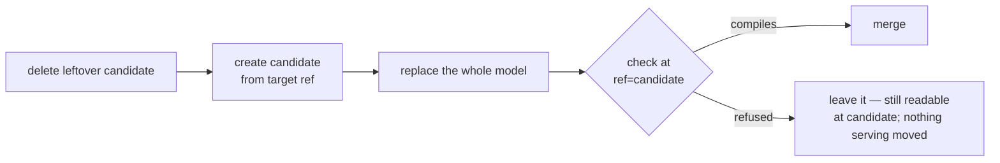

# The data model

## Generating it — `modelstore/modelgen/`

Four stages, each runnable and re-runnable alone: `read` → `cubes` → `describe` → `views`.
`read` caches an `Introspection` rather than writing model files. There is deliberately no
`connect` step — connecting is a form; a step records that something *ran*.

Three invariants:

1. **The LLM returns decisions, never YAML.** Pydantic objects via `with_structured_output`,
   checked against a menu derived from the introspection.
2. **Cube is the validator.** A candidate model goes to the real Cube, and Cube says what is
   wrong. Do not write a YAML checker.
3. **Nothing survives only in memory.** Steps run minutes or days apart; each writes what the
   next needs onto the `deployment` row.

`steps.action` is the only way to run a stage. `publish.install` is the only way a model reaches
Cube, non-destructively:

## Editing it — `modelstore/editing/`, `agent/tools/editor.py`, `api/ide/`

**A ref being edited has a draft on this machine, and the draft is the current model.**
`editing/drafts.py` keeps two trees per ref under `DATA_DIR/drafts/<ref>`: `origin/` as the store
last handed it over, `model/` as being edited, plus `origin.json` with the store revision. That
makes "what have I changed" and "put it back" answerable without the store, and staleness a
revision comparison. There is no git on this side: branching, committing and merging are requests
to the store.

`workspace.py` is the one door for routes and editor tools:

| Entry point | Does | UI |
|---|---|---|
| `stage` | tiers 1–2, writes nothing. `write`/`delete` are an overlay for a proposal not yet written | — |
| `verify` | tiers 1–3 plus impact on saved queries, on a throwaway ref it then deletes | **Validate** |
| `publish` | tiers 1–2, then one commit at the store — this is the deploy | **Publish** |
| `land` | fast-forward, else rebase, else replay onto a fresh branch off main | **Merge…** |

Everything from `verify` on is set-shaped: a change spanning two files cannot compile one at a
time. Cubes are append-only; views are freely rewritable and diffed against main. Main is
generated and never edited — `workspace.editable` refuses it and so does the store.

The store takes one file per request and commits separately. `ModelStore.edit` is deletes, then
writes, then one commit (skipped when nothing changed, since the store refuses an empty one).

## Cube behaviours that forced the design

- **Cube compiles every `*.yml` under the model mount**, not just `cubes/` and `views/`. One stray
  YAML elsewhere takes it to zero cubes, so other paths are refused.
- **A model change is live within seconds, with no restart.** `cube.py` keys the compiled-model
  cache on `<ref>@<rev>`. This is why the edit gate runs *before* the write.
- **Cube qualifies a single-identifier `sql:` but passes an expression through verbatim**, so
  `quantity * unit_price` breaks once a join is involved. `decide.qualify_expression` adds
  `{CUBE}.`.
- **`CUBEJS_DEV_MODE=true` disables JWT verification.** Catalog reads come from
  `information_schema` instead of the dev-mode endpoint.
- **Production Cube refuses to query without Cube Store.**
- **A stored `dateRange` is not a window.** Cube resolves `"last 30 days"` at execution time;
  `LoadResult.resolved_ranges` reads back what it chose.
