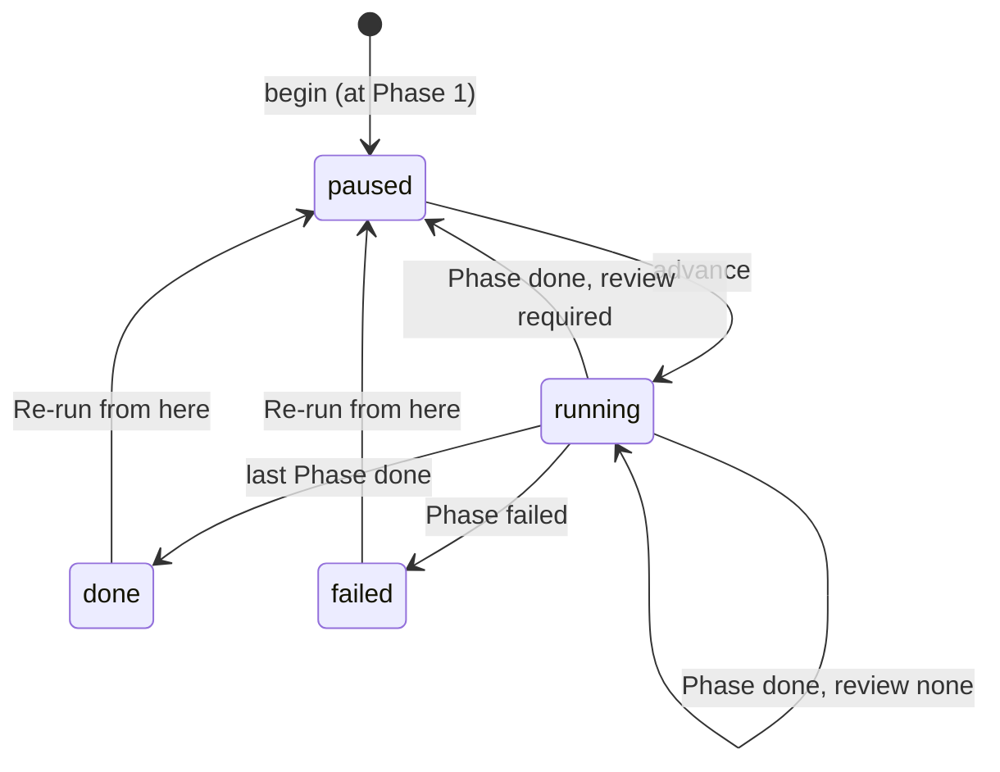

# The Flow engine

`src/praxis/flows/`, tier 3. For what a Flow *is*, see [Flow authoring](../flows/index.md);
this page is how it runs.

| Module | Holds |
|---|---|
| `layout.py` | Every path a Flow has, and `writable` — the line between definition and record |
| `contract.py` | `FlowSpec`, `PhaseSpec`, `load` → `(Flow, Report)`. Every write-time check |
| `state.py` | `run.json`: `RunState`, `PhaseState`, `begin`, `mark_stale_after`, atomic `write` |
| `runner.py` | `begin`, `advance`, one Phase, the lock, collecting outputs |
| `prompt.py` | Everything an agent Phase's model sees |
| `tools.py` | Phase tools: `extract`, `extract_prepared`, `run_prepared`, `write_output` |
| `authoring.py`, `chat.py` | The flow chat: its tools and prompt |
| `events.py` | The run's `events.jsonl` sink |

## A run

`advance` is the only entry point a route needs. It holds the Flow's lock (`run.lock`, `fcntl` —
deliberately not `core.jobs`, whose lock is machine-wide) and runs Phases until a Gate, a failure,
the end, or a cancel. A Phase with `review: none` is run *through*.

One Phase:

1. Mark it `running`, and the run `running`.
2. **Gather**: read prepared queries and scripts, read Reference inputs (clipped at 20,000
   characters), and upload every Working input to the run's sandbox workspace
   (`flow-<flow>-<run>`), deleting a same-named file first — the sandbox renames on collision,
   and the edit made at a Gate must be the file the next Phase reads. Tabular inputs become
   profiles for the prompt.
3. Snapshot the workspace listing, so only this Phase's new files are collected.
4. Execute: a script Phase posts one `.py` to `sandbox.run`; an agent Phase is one `run_turn`
   with `ModelCallLimitMiddleware(20, exit_behavior="error")` and a `run_python` limit of 8.
5. **Collect**: new sandbox files go to `output/` if declared, `scratch/` otherwise. A file from
   the sandbox wins over one `write_output` wrote.
6. Check every declared output exists, and no declared `.csv`/`.tsv` outside `may_be_empty` is
   header-only.
7. Mark later `done` Phases `stale`, and write `run.json` atomically.

**Everything that goes wrong fails the Phase**, which is why a Phase does not run under the
chat's `exit_behavior="end"`: an unattended run that writes a confident artifact from half the
work is worse than one that stops. A cancelled stream (closed tab, restart) is caught as
`BaseException`, recorded as *the phase stopped before it finished*, and re-raised.

## Two kinds of pause

| | Gate | Approval |
|---|---|---|
| Where | between Phases | inside a Phase |
| Recorded | `run.json` (`waiting: "gate"`) | an in-memory queue |
| Survives restart | yes | no — the Phase fails |

## Prepared work and approvals

`build_phase_tools` sets `session.prepared = {text: name}` from the Phase's scripts. `run_python`
skips approval when the script text matches exactly. `session.wrote` records files any script
wrote, and `write_output` refuses those names and names `extract` wrote — a model can never
replace data with a transcription.

## Tests

The deterministic half is covered: contract parsing and each refusal, path-root resolution,
which checks belong to write time versus run time, `run.json` transitions including Stale,
`layout.writable`, and which artifact a Gate permits. A real run needs both services and a model,
so it is verified by running one.
