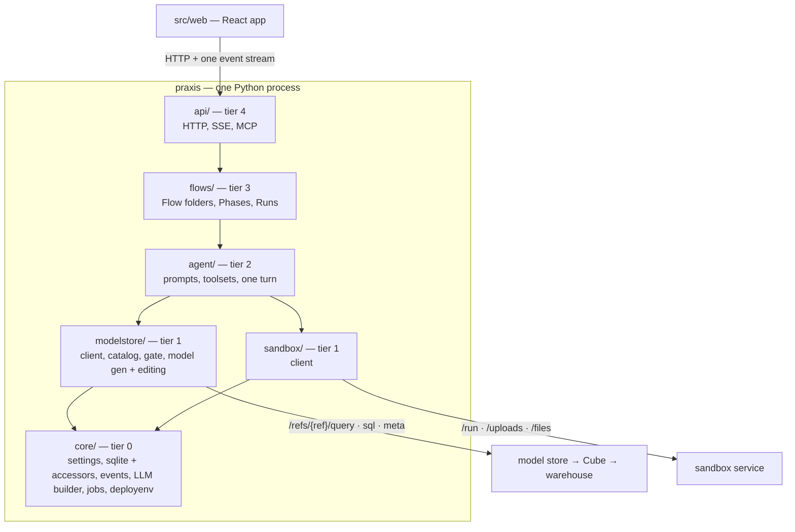

# Architecture

This section is for contributors. It explains how the code fits together and why. `CLAUDE.md` at
the repository root is the fuller, denser version, written for agents and maintainers; this
section is the readable map, and [the glossary](../glossary.md) says what each domain word means.

## The shape

Five ideas carry most of the design:

1. **The agent never writes SQL.** It writes Cube JSON queries that pass a four-tier gate.
   → [The query gate](query-gate.md)
2. **The LLM returns decisions, never YAML, and Cube is the validator.**
   → [The data model](data-model.md)
3. **One flat event stream is the contract between agent and browser, and the event log is the
   transcript.** → [Events and the transcript](events.md)
4. **A Flow is a folder.** Definition, runs and state are files, not rows.
   → [The Flow engine](flow-engine.md)
5. **The portal runs nothing.** It renders compose files and is told addresses.
   → [The two deployments](../operations/deployment.md)

And one rule enforced by a test: **a package may import only its own tier or below.**
→ [Layering](layering.md)
