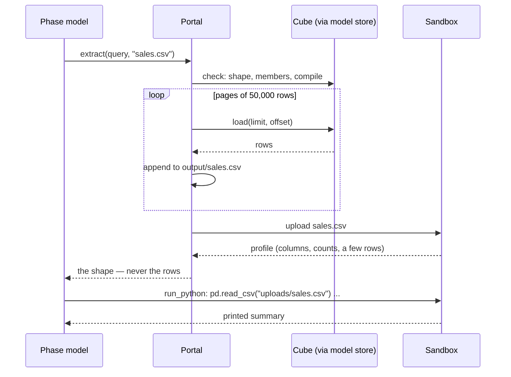

# Getting data into a Phase

This is the most important rule of a Flow: **data goes to files, not to the model.**



## `extract`

`extract(query, filename)` runs a Cube JSON query and writes **every** row to a CSV:

- The query passes the same checks a chat query does — shape, member names, operators,
  granularities, and Cube compiling it — before anything runs. A rejection comes back as text the
  model can fix, e.g. *"`orders.cnt` does not exist. Closest matches: orders.count"*.
- Rows are read from Cube in pages (`FLOW_PAGE_ROWS`, default 50,000 — Cube's per-request
  maximum) and written straight to disk. Memory holds one page, whatever the result's size.
- There is no 5,000-row cap. Leave `limit` out to get every row; set it only for a top-N.
- The ceiling is `FLOW_MAX_ROWS` (default 5,000,000). A result larger than that writes
  **nothing** — a file cut at the ceiling would look finished and not be. Narrow the query or
  split it, one file per time window.
- The header row is the **member ids**, in order, e.g. `daily_sales.sale_date.day,
  daily_sales.dim_stores_region,daily_sales.total_revenue`. A grouped time dimension gives a
  column per granularity as well as the base one. `check_query` in the flow chat returns this
  exact header, so scripts can be written against it.
- A filename that is one of `outputs:` lands in `output/`; any other `.csv` name lands in
  `scratch/`.

Paging by offset is safe because every Cube result has a total order available: there is no
ungrouped mode, so no two rows share every dimension value. The portal appends each dimension to
the query's order so no row moves between pages.

## What the model sees

The model gets the file's **profile**, never its rows:

```text
### sales_by_store_daily.csv — 1.2 MB, 19,488 rows × 7 columns
- daily_sales.sale_date (time) — 28 distinct, 2026-09-01 … 2026-09-28
- daily_sales.dim_stores_region (string) — 4 distinct
- daily_sales.dim_stores_store_id (string) — 174 distinct
- daily_sales.total_revenue (number) — 0.0 … 18420.5
  2026-09-01 | North | S001 | ...
```

No rows reach the run's event log either: an `extract` event carries the query, Cube's SQL, the
row count and the columns, and no preview.

## Working with the file

A Phase with the `python` bundle reads the file in the sandbox:

```python
import pandas as pd

df = pd.read_csv("uploads/sales_by_store_daily.csv")
# ... compute ...
df.to_csv("wow_by_store.csv", index=False)  # a declared output, by its plain name
print(f"{len(df):,} stores, revenue {df['revenue'].sum():,.0f}")  # aggregates, never rows
```

- Every working input and every extract of this Phase is at `uploads/<filename>`.
- A file written by its plain name is collected after the Phase: into `output/` if declared,
  `scratch/` otherwise.
- One sandbox workspace per run, so Phase 3's script can see Phase 1's files too. Only files the
  Phase *declares as inputs* are re-uploaded fresh, which is what makes an edit at a Gate the
  version the next Phase reads.
- Print counts and totals from the script that makes a file. Never print the file afterwards.
- An agent Phase may call `run_python` at most 8 times and the model at most 20 times; past
  either limit the Phase fails rather than writing its best guess.

## A Phase without `python`

A Phase with no `python` bundle cannot open a file. It sees the shape — columns, counts, a few
rows — and is told to say so if the question needs more. That is the right design for a writer
Phase that works from small summary CSVs an earlier script produced. If the writer needs exact
numbers from a big table, have the earlier script compute and save those numbers as a small
output.
