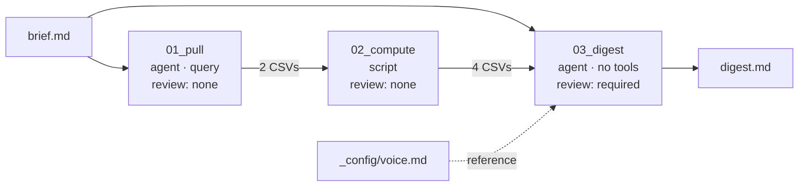

# Example: weekly sales digest

A complete three-Phase Flow: pull daily sales, compute week-over-week movers with a fixed script,
and write a one-page digest for regional managers. It was written by the flow chat and has run
end to end.



```
flows/sales-digest/
  flow.yml
  CONTEXT.md
  _config/voice.md
  phases/
    01_pull/
      phase.yml
      CONTEXT.md
      queries/sales_by_region_category_daily.json
      queries/sales_by_store_daily.json
    02_compute/
      phase.yml
      CONTEXT.md
      compute_wow.py
    03_digest/
      phase.yml
      CONTEXT.md
```

## flow.yml

```yaml
title: Weekly Sales Digest
description: Produces a weekly sales digest with week-over-week sales and revenue movements by region and category.
```

## 01_pull — get the data

An agent Phase so it can read the brief and decide whether the store-level cut is needed. Its two
queries are prepared, so the agent's whole job is choosing which to run.

```yaml
kind: agent
review: none
tools: [query]
inputs:
  - working: brief.md
outputs:
  - sales_by_region_category_daily.csv
  - sales_by_store_daily.csv
may_be_empty:
  - sales_by_store_daily.csv          # header-only when the brief asks nothing about stores
queries:
  - sales_by_region_category_daily.json
  - sales_by_store_daily.json
```

`queries/sales_by_region_category_daily.json` — no `dateRange`, so the window is cut from the
data in the next Phase, not from the clock:

```json
{
  "measures": ["daily_sales.total_units_sold", "daily_sales.total_revenue"],
  "dimensions": [
    "daily_sales.sale_date",
    "daily_sales.dim_stores_region",
    "daily_sales.dim_items_category"
  ],
  "timeDimensions": [{ "dimension": "daily_sales.sale_date", "granularity": "day" }],
  "order": [
    ["daily_sales.sale_date", "asc"],
    ["daily_sales.dim_stores_region", "asc"],
    ["daily_sales.dim_items_category", "asc"]
  ]
}
```

The Phase's `CONTEXT.md` tells the agent: always `extract_prepared` the region/category query;
run the store query only when the brief asks something like "which North stores drove the
change"; otherwise write the store CSV as a header only.

## 02_compute — the arithmetic

A script Phase: no model, the same computation every run.

```yaml
kind: script
review: none
script: compute_wow.py
inputs:
  - working: 01_pull/output/sales_by_region_category_daily.csv
  - working: 01_pull/output/sales_by_store_daily.csv
outputs: [wow_by_region.csv, wow_by_category.csv, wow_by_store.csv, movers.csv]
may_be_empty: [wow_by_store.csv]
```

The heart of `compute_wow.py`: inputs from `uploads/`, column names exactly as `check_query`
reported them, the window from the data's own dates, outputs by plain name, and a summary
printed instead of rows.

```python
df = pd.read_csv("uploads/sales_by_region_category_daily.csv")
df = df.rename(
    columns={
        "daily_sales.sale_date": "date",
        "daily_sales.dim_stores_region": "region",
        "daily_sales.dim_items_category": "category",
        "daily_sales.total_units_sold": "units",
        "daily_sales.total_revenue": "revenue",
    }
)
df["date"] = pd.to_datetime(df["date"])

# The latest 14 dates in the data — not the machine clock.
dates = sorted(df["date"].unique())[-14:]
last_week, this_week = dates[:7], dates[7:]
...
wow_region.to_csv("wow_by_region.csv", index=False)
print(f"Regions this week: {df_tw['region'].nunique()}, categories: {df_tw['category'].nunique()}")
```

## 03_digest — the writing

No bundles: it turns four small summary tables into prose and has no reason to touch the
warehouse. `review: required` stops the run here so a person reads the digest before it goes out.

```yaml
kind: agent
review: required
inputs:
  - reference: _config/voice.md
  - working: brief.md
  - working: 02_compute/output/wow_by_region.csv
  - working: 02_compute/output/wow_by_category.csv
  - working: 02_compute/output/wow_by_store.csv
  - working: 02_compute/output/movers.csv
outputs:
  - digest.md
```

`_config/voice.md` holds the audience, tone and content priorities. Because it is a `reference:`,
the model reads it word for word on every run, and changing the house voice is one edit in one
file.

## Running it

| Brief | What changes |
|---|---|
| *(empty)* | Region and category digest |
| *Focus on Region North* | Same data; 03 leads with North |
| *Which North stores drove the change?* | 01 also runs the store query; 02 fills `wow_by_store.csv`; 03 names the stores |
