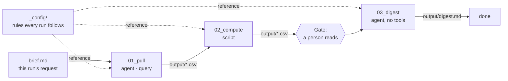

# Flow authoring

A **Flow** is data work you repeat — "every Monday, pull last week's sales, compute the movers,
write a digest for the regional managers". It runs as numbered **Phases**, one after another,
and a person can read what each Phase made before the next one starts.

This section is for whoever writes Flows. To *run* one, see [Run a Flow](../user-guide/running-flows.md).

## The ideas in one page

| Idea | What it means |
|---|---|
| **The folder is the Flow** | There is no database row and no builder. Editing the files is how a Flow changes, and a Flow can live in git. |
| **The number is the order** | `phases/01_pull` runs before `phases/02_compute`. Number them `01`, `02`, `03`, with no gaps. |
| **One Phase, one job** | A Phase that fetches does not also interpret. A bad plan is cheap to fix at a Gate and expensive to unpick from a finished report. |
| **Two kinds of Phase** | `kind: agent` is one model turn with the tools it asks for. `kind: script` runs one Python file and calls no model. |
| **Two kinds of input** | A **reference** input is a rule from the Flow's folder, the same every run, and the model reads it word for word. A **working** input is material from *this* run: the brief or an earlier Phase's output. |
| **Data goes to files, not to the model** | A query writes every row to a CSV. The model sees only the file's *shape*: columns, row count, a few rows. |
| **Prepared work** | Queries and scripts are written once, when the Flow is written, and a run executes them as they are. |
| **Gates** | After a Phase with `review: required`, the run stops so a person can read — and edit — what it made. |
| **Fail loudly** | Anything that goes wrong fails the Phase and stops the run. A run never leaves a half-made file that looks finished. |

## Where to go next

- [Folder layout](layout.md) — every file and folder a Flow and a run have.
- [phase.yml reference](reference.md) — every field, with what it accepts.
- [Getting data into a Phase](data.md) — `extract`, shapes, and the sandbox.
- [Prepared work](prepared-work.md) — writing queries and scripts that run first time.
- [What fails a Phase](failures.md) — every check, and how to fix each one.
- [The flow chat](authoring-chat.md) — letting an agent write the Flow for you.
- [Example: weekly sales digest](example.md) — a complete three-Phase Flow, file by file.

The design follows *Interpretable Context Methodology* (arXiv:2603.16021). Why a Flow is files
and not rows is recorded in [decision 0006](../adr/0006-a-flow-keeps-its-state-in-its-folder.md).
