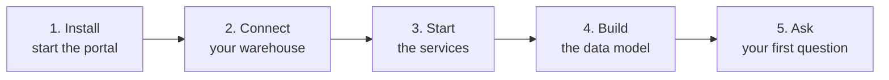

# Get started

These five steps go from nothing to an answered question, in order. Each step ends where the next
one begins.

| Step | You do | You end with |
|---|---|---|
| [1. Install and start the portal](install.md) | Clone, fill in `.env`, `make web` | The portal open on its setup screen |
| [2. Connect your warehouse](connect.md) | Fill in the connection form | Connection settings stored; nothing contacted yet |
| [3. Start the services](services.md) | Download two compose files, `docker compose up -d`, paste two addresses | The semantic layer and the sandbox running and checked |
| [4. Build the data model](build-the-model.md) | Pick tables, click **Build** | Cube serving a model of your data |
| [5. Ask your first question](first-question.md) | Type a question | An answer, with the query and every step behind it |

## Before you begin

| You need | For |
|---|---|
| Python 3.12+ and [uv](https://docs.astral.sh/uv/) | the portal |
| Node.js 22 and npm | building the browser app |
| Docker with Compose | the two services the portal talks to |
| An Azure OpenAI deployment, API version `2025-03-01-preview` or later | every agent |
| A warehouse Docker can reach, and a user that can read it | Cube connects to it; the portal never does |

Steps 2 to 4 happen on the portal's setup screen, **Set up your data**, whose four numbered steps
open one after another. Steps 4 and 5 call the AI; the rest do not.

--8<-- "docs/.snippets/ui-setup.html"

Set up your data

The portal runs nothing itself. You give it a connection, it gives you a file per deployment, and you run those wherever you like — this machine or a server. Then it needs the addresses back, and it builds your data model.

<ol class="ui-steps">
<li class="done">✓

Your database or warehouse
<strong>retail</strong> · PostgreSQL — stored, and the deployment secrets are minted.
</li>
<li class="live">2

The semantic layer

Cube, the model store that holds your data model, and Cube Store. Everything the agent answers comes through it.
⤓ Download docker-compose.yml
</li>
<li class="later">3

The sandbox
Once the previous step is done.
</li>
<li class="later">4

The data model
Once the previous step is done.
</li>
</ol>

The setup screen once step 1 is done — the semantic layer is next.

**Start:** [1. Install and start the portal](install.md)
