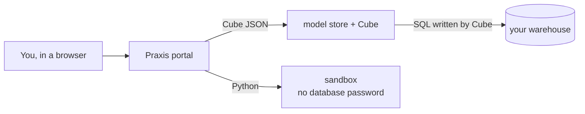

praxis by rustify
<h1>Ask your warehouse questions. Get answers you can check.</h1>

praxis builds a semantic layer on your SQL warehouse, answers plain-English
questions through queries checked against it, and runs the data work you repeat in numbered steps,
with a person checking each one.

[Get started](getting-started/index.md){ .md-button .md-button--primary }
[How it works](#how-it-works){ .md-button }

<figure class="ax-video">
<video autoplay muted loop playsinline controls preload="auto" poster="assets/demo/portal-tour.png">
  <source src="assets/demo/portal-tour.mp4" type="video/mp4">
</video>
<figcaption>One minute in the portal, against a retail warehouse: a question becomes a checked Cube
query and a chart, then the model it was checked against, then a four-step Flow Run.</figcaption>
</figure>

<strong>The AI never writes SQL</strong>It writes a Cube query that is checked against your model before it reaches the warehouse. A wrong name comes back with the nearest real one.

<strong>Every step is on screen</strong>The model search, the query, any rejection and retry, the SQL Cube made, and the rows — not just the answer.

<strong>Repeated work, written down</strong>A Flow is a folder of numbered steps. Rows go to files, not to the AI, and a person reads each step before the next.

## How it works

1. **Connect** almost any SQL warehouse — Postgres, Snowflake, BigQuery, Databricks and more.
2. **Build a semantic layer** on it: what each table means, how tables join, which numbers can be
   added up.
3. **Ask.** Each question becomes a Cube query, checked against the model before it runs. The AI
   talks to Cube; only Cube talks to the warehouse.
4. **Repeat.** Keep questions on dashboards, and turn work you do every week into a Flow.

## Find your way

<a class="ax-card" href="getting-started/"><svg viewBox="0 0 24 24"><path d="m13.13 22.19-1.63-3.83c1.57-.58 3.04-1.36 4.4-2.27zM5.64 12.5l-3.83-1.63 6.1-2.77C7 9.46 6.22 10.93 5.64 12.5M19.22 4c.28 0 .53 0 .74.05.17 1.39-.02 4.25-3.3 7.53-1.7 1.71-3.73 3.02-6.01 3.89l-2.15-2.1c.92-2.31 2.23-4.34 3.92-6.03C15.18 4.58 17.64 4 19.22 4m0-2c-1.98 0-4.98.69-8.22 3.93-2.19 2.19-3.5 4.6-4.35 6.71-.28.75-.09 1.57.46 2.13l2.13 2.12c.38.38.89.61 1.42.61.23 0 .47-.06.7-.15A19.1 19.1 0 0 0 18.07 13c5.66-5.66 3.54-10.61 3.54-10.61S20.7 2 19.22 2m-4.68 7.46c-.78-.78-.78-2.05 0-2.83s2.05-.78 2.83 0c.77.78.78 2.05 0 2.83s-2.05.78-2.83 0m-5.66 7.07-1.41-1.41zM6.24 22l3.64-3.64c-.34-.09-.67-.24-.97-.45L4.83 22zM2 22h1.41l4.77-4.76-1.42-1.41L2 20.59zm0-2.83 4.09-4.08c-.21-.3-.36-.62-.45-.97L2 17.76z"/></svg><strong>Get started</strong>Install, connect a warehouse, build a model and ask your first question. Five steps, in order.New here</a>
<a class="ax-card" href="user-guide/"><svg viewBox="0 0 24 24"><path d="M20 2H4c-1.1 0-2 .9-2 2v18l4-4h14c1.1 0 2-.9 2-2V4c0-1.1-.9-2-2-2m0 14H5.2L4 17.2V4h16zM12.2 5.5c-.9 0-1.6.2-2.1.5-.6.4-.9 1-.8 1.7h2q0-.45.3-.6c.2-.1.4-.2.7-.2s.6.1.8.3.3.4.3.7-.1.5-.2.7c-.2.2-.4.4-.6.5-.5.3-.9.6-1.1.8-.4.3-.5.6-.5 1.1h2c0-.3.1-.5.1-.7.1-.2.3-.3.5-.5.5-.2.8-.5 1.1-.9s.4-.8.4-1.2c0-.7-.3-1.3-.8-1.7-.4-.3-1.2-.5-2.1-.5M11 12v2h2v-2z"/></svg><strong>User guide</strong>Questions, dashboards, running a Flow, changing the model, and sharing tools with other agents.Using the portal</a>
<a class="ax-card" href="flows/"><svg viewBox="0 0 24 24"><path d="M7 13v-2h14v2zm0 6v-2h14v2zM7 7V5h14v2zM3 8V5H2V4h2v4zm-1 9v-1h3v4H2v-1h2v-.5H3v-1h1V17zm2.25-7a.75.75 0 0 1 .75.75c0 .2-.08.39-.21.52L3.12 13H5v1H2v-.92L4 11H2v-1z"/></svg><strong>Flow authoring</strong>Folders, <code>phase.yml</code>, prepared queries and scripts, and every check that fails a Phase.Writing Flows</a>
<a class="ax-card" href="operations/"><svg viewBox="0 0 24 24"><path d="M2 4.6v4.8c0 .9.5 1.6 1.2 1.6h17.7c.6 0 1.2-.7 1.2-1.6V4.6C22 3.7 21.5 3 20.8 3H3.2C2.5 3 2 3.7 2 4.6M10 8V6H9v2zM5 8h2V6H5zm15 1H4V5h16zM2 14.6v4.8c0 .9.5 1.6 1.2 1.6h17.7c.6 0 1.2-.7 1.2-1.6v-4.8c0-.9-.5-1.6-1.2-1.6H3.2c-.7 0-1.2.7-1.2 1.6m8 3.4v-2H9v2zm-5 0h2v-2H5zm15 1H4v-4h16z"/></svg><strong>Operating</strong>The two deployments, every setting, security, upgrading, and troubleshooting by error message.Running it</a>
<a class="ax-card" href="architecture/"><svg viewBox="0 0 24 24"><path d="M21 16v-3c0-1.11-.89-2-2-2h-6V8h2V2H9v6h2v3H5c-1.11 0-2 .89-2 2v3H1v6h6v-6H5v-3h6v3H9v6h6v-6h-2v-3h6v3h-2v6h6v-6zM11 4h2v2h-2zM5 20H3v-2h2zm8 0h-2v-2h2zm8 0h-2v-2h2z"/></svg><strong>Architecture</strong>Layering, the query gate, the event stream, the Flow engine, storage, and the decisions behind them.Working on it</a>
<a class="ax-card" href="api/"><svg viewBox="0 0 24 24"><path d="M7 7H5a2 2 0 0 0-2 2v8h2v-4h2v4h2V9a2 2 0 0 0-2-2m0 4H5V9h2m7-2h-4v10h2v-4h2a2 2 0 0 0 2-2V9a2 2 0 0 0-2-2m0 4h-2V9h2m6 0v6h1v2h-4v-2h1V9h-1V7h4v2Z"/></svg><strong>Reference</strong>Every HTTP route, the MCP tools, and the glossary of what each word means.Integrating</a>

