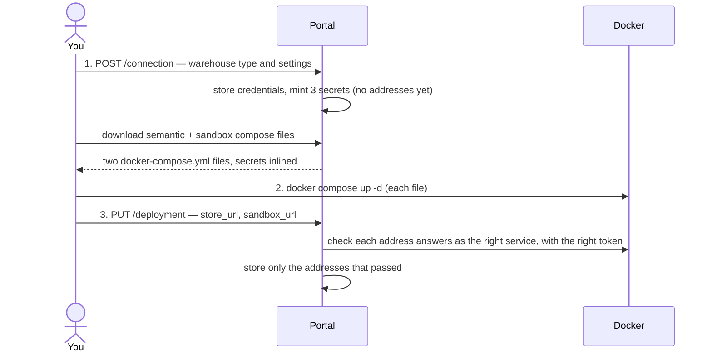

# The two deployments

There are two deployments, and they share nothing — no network, no volume, no secret.

| | Semantic deployment | Sandbox |
|---|---|---|
| Compose project | `praxis-semantic` | `praxis-sandbox` |
| Services | `modelstore`, `cube-api`, `cubestore` | `sandbox` |
| Published port | `127.0.0.1:8000` (model store) | `127.0.0.1:8600` |
| Volumes | `model` (every data model you have — **back it up**), `cubestore` | `workspaces` |
| Needed for | everything: the model, every query | running Python: chat scripts, file uploads, Flows. Required by onboarding |
| Holds | the warehouse credentials, `CUBEJS_API_SECRET` | no credential at all |

## Connecting is two steps

The portal cannot start a container, so connecting has a step in the middle that you do.

1. **Setup step 1** (or **Data → … → Edit connection** later). Pick the warehouse type and fill in
   the form. The portal stores
   the settings and mints three secrets: Cube's API secret, the model store token and the sandbox
   token.
2. **Download both compose files**, put each in its own folder, and run `docker compose up -d`
   next to each. The files are generated each time you download them; nothing is written to disk
   by the portal.
3. **Paste the two addresses** — `http://127.0.0.1:8000` and `http://127.0.0.1:8600` by default.
   Each is checked before it is stored, and a wrong one is refused with a reason (see
   [Troubleshooting](troubleshooting.md#connecting)).

The same address step is used again if a deployment moves.

### Four conditions, not one

| Condition | Meaning | Costs a request? |
|---|---|---|
| **deployed** | a model store address is stored | no |
| **onboarded** | both addresses are stored, and there is a model | no |
| **reachable** | something answers at the address, and it is the right service | yes |
| **serving** | Cube is compiling a model | yes |

None of the checks proves the *warehouse password* is right. The first thing that connects to the
warehouse is the **Read tables** step.

## Warehouses

| Type | Required settings |
|---|---|
| Postgres, MySQL, SQL Server, Redshift | `CUBEJS_DB_HOST`, `CUBEJS_DB_NAME`, `CUBEJS_DB_USER` |
| ClickHouse | `CUBEJS_DB_HOST` |
| Snowflake | `CUBEJS_DB_SNOWFLAKE_ACCOUNT`, `CUBEJS_DB_SNOWFLAKE_WAREHOUSE`, `CUBEJS_DB_NAME`, `CUBEJS_DB_USER` |
| BigQuery | `CUBEJS_DB_BQ_PROJECT_ID`, `CUBEJS_DB_BQ_CREDENTIALS` (a service account key) |
| Databricks (JDBC) | `CUBEJS_DB_DATABRICKS_URL`, `CUBEJS_DB_DATABRICKS_ACCEPT_POLICY` (the form ticks it) |
| Athena | `CUBEJS_AWS_KEY`, `CUBEJS_AWS_SECRET`, `CUBEJS_AWS_REGION`, `CUBEJS_AWS_S3_OUTPUT_LOCATION` |
| Trino | `CUBEJS_DB_HOST`, `CUBEJS_DB_USER`, `CUBEJS_DB_PRESTO_CATALOG` |
| DuckDB | nothing — no path means an in-memory database |

A password is never *required* (some warehouses authenticate otherwise), and a type not in this
table is accepted with whatever `CUBEJS_DB_*` / `CUBEJS_AWS_*` settings you type. Settings with any
other prefix are refused.

!!! tip "A database on your own machine"
    From inside a container, your machine is `host.docker.internal`, not `localhost`.

Databricks needs Cube's JDK image: change the `cube-api` image to `cubejs/cube:<version>-jdk`
with `platform: linux/amd64`. The rendered file's comment says so.

## Inside the semantic deployment

- **`modelstore`** owns the data model's files and their history, and is the **only door to
  Cube**. It serves queries at `/refs/{ref}/query`, `/refs/{ref}/sql` and `/refs/{ref}/meta`,
  minting a short-lived JWT for Cube that names the ref and its revision. Health check:
  `GET /healthz`.
- **`cube-api`** runs the stock `cubejs/cube` image with a `cube.py` supplied through compose
  `configs`. Its port is **not published**. `CUBEJS_DEV_MODE` is `false`, because dev mode turns
  off JWT verification. Each ref and revision compiles separately, so a model change is live
  within seconds with no restart.
- **`cubestore`** is required: production-mode Cube answers `/meta` without it but refuses every
  query.

!!! warning "Apple Silicon and Cube Store"
    Cube Store publishes one architecture per tag, with no multi-arch manifest. The wrong one
    fails at `docker compose up` with **no matching manifest**. The portal picks the tag from the
    architecture of the machine *rendering* the file (`-arm64v8` suffix on arm64). If you run the
    file on a different machine, change that one line; the file's comment marks it.

## Inside the sandbox

One service, hardened: 2 GB memory, 2 CPUs, 512 processes, all capabilities dropped,
`no-new-privileges`. It holds no warehouse credential and cannot sign a Cube token, which is what
keeps the query gate load-bearing even though the agent's Python runs here. It **can** reach the
network, so its port is bound to loopback and its token is mandatory.

Each chat and each Flow run gets its own workspace directory in the `workspaces` volume. Timeouts
are written into the file: `SANDBOX_EXEC_TIMEOUT_S=120` and `SANDBOX_PROFILE_TIMEOUT_S=60`.
