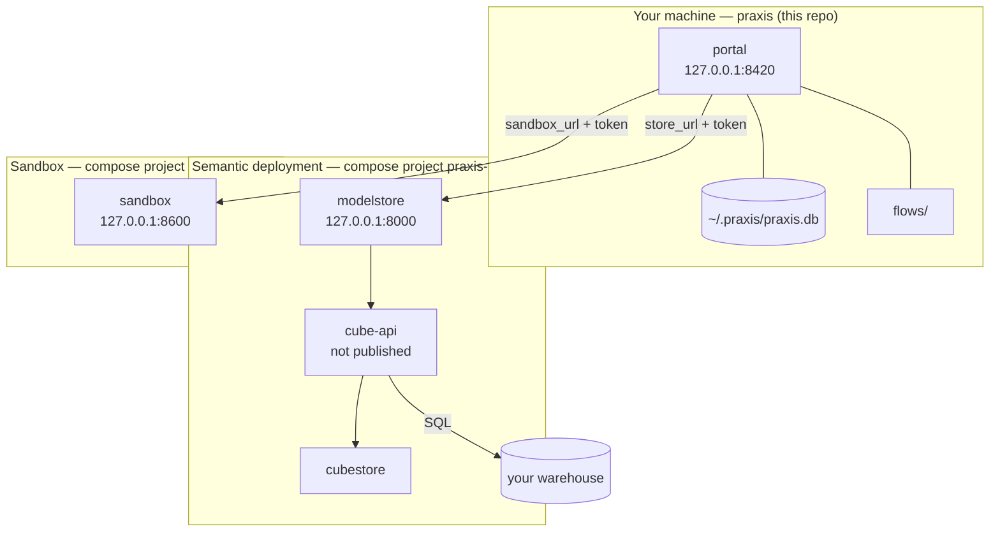

# Operating

This section is for whoever brings up praxis's services and keeps them running. A first
install is [Get started](../getting-started/index.md); this is everything after it.

**The portal runs nothing.** It holds credentials, mints secrets, renders a `docker compose` file
per service, and is told where those services are. It never starts, stops or watches a container.
So there are three things to run, owned separately:

| Page | What it covers |
|---|---|
| [The two deployments](deployment.md) | What each compose file contains, and the connect → hand over → paste addresses sequence |
| [Configuration](configuration.md) | Every setting in `.env` |
| [Security](security.md) | Where secrets live, what holds which credential, what is exposed |
| [Upgrading](upgrading.md) | Image pins, and why a pin is the only compatibility control |
| [Troubleshooting](troubleshooting.md) | Every common error, by the words you see |
