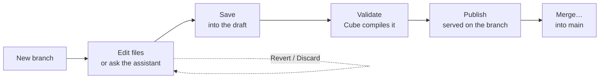

# Change the model

Open **Data**. The model editor shows the model's YAML files, grouped as **Cubes** (*one per
table, append-only*) and **Views** (*what a question can reach*).

**`main` is read-only.** It is what every chat and every dashboard reads, and it is generated by
the build. To change anything, make a **branch**.

--8<-- "docs/.snippets/ui-data.html"

⑂ add-margin ▾FilesServed modelSaveValidatePublish 1Merge…

Cubes

dim_items.yml

dim_stores.yml

fact_daily_sales.yml

Views

daily_sales.yml

measures:  - name: total_revenue    sql: revenue    type: sum  - name: gross_margin    sql: "{CUBE}.revenue - {CUBE}.cost"    type: sum    description: Revenue minus cost of goods.  - name: total_units_sold    sql: units

Assistant

Add a gross margin measure to daily sales

✓Reading cubes/fact_daily_sales.yml

✓Compiling the proposed model

<b>Change</b> <code>cubes/fact_daily_sales.yml</code> +4 −0
Review

Cube compiled it. Ready to publish.

Editing on the branch <code>add-margin</code>: one file saved and validated, ready to publish. The assistant on the right proposed the change; it never writes a file itself.

## The cycle

1. **Branch.** Click the branch button (⑂ main) → **New branch…**, name it (e.g. `add-margin`),
   pick what to branch from, **Create**.
2. **Edit.** Open a file from the tree and type, or click **+ View** for a new view. Or ask the
   assistant on the right.
3. **Save N** writes your edits into the branch's draft. Nothing compiles yet.
4. **Validate** asks Cube to compile the whole draft on a throwaway branch, and checks every saved
   dashboard query against it. *Cube compiled it. Ready to publish.*
5. **Publish N** commits the draft to the branch. Cube serves it on that branch within seconds —
   no restart.
6. **Merge…** shows the files that changed, the patch, and whether any saved query breaks, then
   **Merge into main**. It can delete the branch afterwards (ticked by default).

Only the next step's button is enabled. The **Problems** panel under the editor lists what is
wrong: errors that stop it compiling, and things that compile but fail later — including
*N of M saved queries would break*, with the closest member names.

## Rules Cube enforces through the editor

- **Cubes are append-only.** Add members and descriptions; do not rename or remove. Dashboards
  and saved queries depend on the names.
- **Views can be changed freely.**
- Files must be `cubes/*.yml` or `views/*.yml`. Cube compiles every YAML under the model, and one
  stray file elsewhere would take it to zero cubes.
- A multi-column `sql:` expression needs `{CUBE}.` before each column, or it fails with an
  ambiguous-column error once a join is involved.

## Undoing

| Where | Does |
|---|---|
| **Revert** (solid dot — typed, not saved) | Undo your typing in that file |
| **Discard** (hollow dot — saved, not published) | Reset that file to the branch's published version |
| Delete branch (bin icon) | Type the branch name to confirm. Anything never merged is lost; main is untouched |

A merge that would break saved dashboard queries is offered as the red **Merge anyway, breaking
N**. Prefer fixing the tiles first.

## The assistant

On a branch, the right-hand pane is an assistant for the model. *It reads before it proposes, and
it saves nothing — every change comes back as a diff for you to accept. It cannot commit or
merge.* Try:

- *Describe the measures on invoice_line*
- *Add a gross_amount measure to invoice_line*
- *Make a view of track economics*

Each proposal is a card — **Change path +a −r** — with **Review**, which opens a diff where you
accept or reject each change. Accepted text is an ordinary edit: Save, Validate and Publish as
usual.

## Served model

The **Served model** tab lists every member Cube is actually serving on the current branch, with
a filter. It also lists files that are in the model but not served — usually a file Cube could
not compile.

## Rebuild from scratch

**Data → … → Rebuild the model** runs the build again from a fresh table selection. It asks you
to type `rebuild`, then confirms once more, because **every file on main is replaced in one
commit — hand edits on main included**. The old version stays in the model store's history, and
nothing stops being served while it runs. To keep hand edits, make them on a branch and merge
after rebuilding.

Only one build runs at a time across the machine. The Data icon on the rail shows a dot while one
is running.
